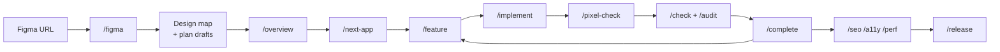

<div align="center">

# figma-next-blueprint

**From a Figma URL to a pixel-perfect Next.js site, built one reviewed feature at a time.**

Next.js App Router · TypeScript · Tailwind CSS v4 · shadcn/ui · Payload CMS (optional) · Playwright


[Set up a project](#part-1---set-up-a-new-project) ·
[Commands](#commands) ·
[Troubleshooting](#troubleshooting) ·
[Credits](#credits-and-license)

</div>

---

## Quick start

On Windows, work outside OneDrive (for example in `C:\dev`).

```bash
npx create-next-app@latest my-site --ts --tailwind --app --eslint
cd my-site
npx shadcn@latest init
npm i -D playwright axe-core
npx playwright install chromium
npx create-figma-next-blueprint@latest
```

The last command adds the kit to the root of your site, next to `app/` and
`package.json`; nothing is nested and nothing is overwritten. Add
`FIGMA_TOKEN=figd_your_token_here` to `.env` in your editor (shell redirects can
save it in the wrong encoding on Windows). Then open `my-site` in Claude Code
(or Codex) and run `/onboard`, then
`/figma <figma-url>`. The full walkthrough is in [Part 1](#part-1---set-up-a-new-project).

## Contents

- [Why](#why)
- [How it works](#how-it-works)
- [What's in this repository](#whats-in-this-repository)
- [Requirements](#requirements)
- [Part 1 - Set up a new project](#part-1---set-up-a-new-project)
- [Part 2 - Map the design and build the foundation](#part-2---map-the-design-and-build-the-foundation)
- [Part 3 - Build pages and collections](#part-3---build-pages-and-collections)
- [Part 4 - Launch](#part-4---launch)
- [Commands](#commands)
- [Site structure](#site-structure)
- [Configuration](#configuration)
- [Updating an existing project](#updating-an-existing-project)
- [Tested with](#tested-with)
- [Troubleshooting](#troubleshooting)
- [Maintaining the kit](#maintaining-the-kit)
- [Credits and license](#credits-and-license)

## Why

Turning a Figma file into a site is repetitive and easy to get almost right:
extract colors and type, slice sections, wire content, match every pixel at
every breakpoint. **figma-next-blueprint** gives your AI coding agent a set of
Next.js-specific skills and house rules so it does that work the same way every
time, behind review gates:

- 🎨 **Paste a Figma URL** - tokens, breakpoints, fonts, sections, collections,
  and assets are mapped for you, with node IDs
- 🧩 **One Figma section = one component** - same name in the folder, the
  registry, the content, the Payload block, and `data-section`
- 🎯 **Tokens only** - every color, size, space, radius, and shadow is a
  Tailwind utility generated from Figma; arbitrary values fail review
- 📐 **Measured, not eyeballed** - `/pixel-check` compares computed styles and
  boxes against Figma at every frame width, with overlays and diffs
- 🔒 **Next.js-safe** - zod-validated server actions, no leaked env vars,
  Server Components by default, all checked in review
- 🧾 **Reviewable history** - every feature has a spec, a branch, a review, and
  an archive

It is built on the [AI Blueprint](https://ai-blueprint.dev) spec-driven
workflow, and is the Next.js sibling of
[figma-wp-blueprint](https://github.com/saidMounaim/figma-wp-blueprint).

## How it works



One Figma section becomes one component, and its name is used everywhere:

| Piece | Where |
| --- | --- |
| Component | `components/sections/Hero/Hero.tsx` (Server Component) |
| Props | `components/sections/Hero/Hero.types.ts`, or the generated Payload type |
| Interactive part *(only when needed)* | `components/sections/Hero/HeroSlider.tsx` (`"use client"`) |
| Payload block *(Payload only)* | `components/sections/Hero/Hero.block.ts`, slug `hero` |
| Registry | `hero: Hero` in `components/sections/registry.ts` |
| Measurement hooks | `data-section="hero"` on the root, `data-el="title"` on measured elements |
| Figma link | `"hero"` in `blueprint/design/map.json`, with node IDs per frame width |

Every design value comes from `blueprint/design/tokens.json`, which
`blueprint/scripts/tokens-to-css.mjs` turns into a generated `@theme` block in
`app/globals.css`. shadcn's variables (`--primary`, `--border`, `--radius`, ...)
are mapped onto the same tokens, so shadcn components never show their default
look. The block also tells Tailwind to skip the workflow files (`blueprint/`,
`.claude/`, `.agents/`), so example class names in the docs never reach your
CSS.

## What's in this repository

Everything except `README.md`, `LICENSE`, `package.json`, and `bin/` (the npx
command) goes into the root of your site:

| Path | Contents |
| --- | --- |
| `AGENTS.md` | Project rules and workflow for every AI tool |
| `CLAUDE.md` | Claude Code entry point, imports `AGENTS.md` |
| `.claude/skills/` | The 29 skills for Claude Code |
| `.agents/skills/` | The same skills for Codex, GitHub Copilot, and Antigravity |
| `blueprint/` | Plans, coding standards, design map, specs, reports, history |
| `blueprint/scripts/` | The helpers the skills run: Figma, tokens, pixel, SEO, accessibility, performance |

## Requirements

| Tool | Why |
| --- | --- |
| [Node.js 22+](https://nodejs.org/) | The app and every helper script |
| [Git](https://git-scm.com/) | One branch per feature |
| A Next.js App Router app | Created with `create-next-app` (TypeScript, Tailwind, App Router) |
| [shadcn/ui](https://ui.shadcn.com/) | Interactive primitives (`npx shadcn@latest init`) |
| Figma account and personal access token | View access to the file; the token goes in `.env` |
| [Playwright](https://playwright.dev/) + Chromium | `/pixel-check`, `/a11y`, `/perf`, `/check` |
| [axe-core](https://github.com/dequelabs/axe-core) | `/a11y` |
| An AI coding agent | [Claude Code](https://claude.com/claude-code), Codex, GitHub Copilot, Google Antigravity, or OpenCode |
| [Payload CMS](https://payloadcms.com/) + Postgres *(optional)* | Only when the content source is `payload` |
| [Figma Dev Mode MCP](https://help.figma.com/hc/en-us/articles/32132100833559) *(optional)* | Richer design reads; the scripts still need the token |

The helper scripts need no npm packages of their own. Playwright and axe-core
are dev dependencies of your app; Lighthouse runs through `npx`.

## Part 1 - Set up a new project

### 1. Create the app

```bash
npx create-next-app@latest my-site --ts --tailwind --app --eslint
cd my-site
git init   # if the scaffolder did not
npx shadcn@latest init
```

### 2. Add the kit to the root of the app

From the `my-site` folder:

```bash
npx create-figma-next-blueprint@latest
```

It copies `AGENTS.md`, `CLAUDE.md`, `.claude/`, `.agents/`, and `blueprint/`
into the root of your site, next to `app/`. It stops without copying anything
if the folder is not a Next.js project or if one of those files already exists.
The `AGENTS.md` that `create-next-app` writes is the one exception: it only
holds a Next.js managed block, which the kit's `AGENTS.md` already contains
(`next dev` keeps it up to date).

Without npm, the same files come from Git:

```bash
git remote add blueprint https://github.com/saidMounaim/figma-next-blueprint.git
git fetch blueprint
git checkout blueprint/main -- AGENTS.md CLAUDE.md .claude .agents blueprint
```

Do not `git clone` the kit inside your site: that creates a nested repository
that Tailwind and ESLint would scan.

### 3. Add your Figma token

1. In Figma: **Settings > Security > Personal access tokens > Generate new
   token** with **File content: Read-only** (add **File variables: Read** if you
   use Figma Variables on an Enterprise plan).
2. In the app root, add it to `.env`:

   ```env
   FIGMA_TOKEN=figd_your_token_here
   ```

`.env*` is git-ignored by create-next-app. Never paste the token in chat.

### 4. Install the browser tooling

```bash
npm i -D playwright axe-core
npx playwright install chromium
```

### 5. Open the app in your AI tool and onboard

Open the app root (not this repository) in Claude Code or your agent and run
`/onboard` (`$onboard` in Codex). It checks Node, Git, Tailwind, shadcn, the
token, and Playwright, asks for the content source, and fills in the project
values.

## Part 2 - Map the design and build the foundation

| Step | Command | What happens | What you do |
| --- | --- | --- | --- |
| 1 | `/figma <figma-url>` | Reads the design: tokens, breakpoints, fonts, sections, collections, assets. Writes the design map and reference renders. Drafts the plans. | Review the section list and open questions; approve the plans. |
| 2 | `/overview` | Turns the plans into a numbered build plan and the project overview. | Read it. |
| 3 | `/next-app` | Writes the spec for feature 1: tokens, fonts, layout, header, footer, page renderer, metadata. | Approve the spec. |
| 4 | `/implement` | Builds feature 1 on its own branch. | Run `npm run dev` when asked. |
| 5 | `/pixel-check http://localhost:3000/` | Measures the header and footer against Figma at every width. | Ask for fixes or accept. |
| 6 | `/complete` | Archives the feature, then asks before it commits and merges. | Approve. |

Any Figma link works: `design`, `file`, `proto`, or `board`, with or without
`?node-id=`.

## Part 3 - Build pages and collections

Repeat this loop for each build-plan item:

```text
/feature          spec the next item: Figma nodes and frame widths for every section
/implement        build each section with /section, collections with /collection,
                  assets with /assets
/pixel-check      measure against Figma at every width (required for UI work)
/check            (optional) prove the spec's done-whens in the browser
/audit current    (optional) review with the Next.js lens
/complete         archive, commit, merge
```

For a bug or small change outside the plan, use `/fix "<what is wrong>"`, then
`/implement` and `/complete`. When the designer updates Figma, run
`/design-sync` for a change report and proposed fixes.

## Part 4 - Launch

```text
npm run build
npm run start
/seo http://localhost:3000 --all
/a11y http://localhost:3000
/perf http://localhost:3000
/release vercel
```

Reports land in `blueprint/reports/`. `/release` prepares Vercel or Render
config and readiness checks and stops before any deploy; deploying needs your
separate yes.

## Commands

All skills are typed in your AI chat, not in a terminal. Codex uses `$name`.

### Figma and Next.js skills

| Command | Purpose |
| --- | --- |
| `/figma <url>` | Map the design: tokens, breakpoints, fonts, sections, collections, assets; propose plans |
| `/next-app` | Feature 1: tokens, fonts, layout, header, footer, page renderer, metadata, sitemap, robots |
| `/section <name or url>` | One Figma section: component, props, content or Payload block, map entry, pixel loop |
| `/collection <name>` | Typed content or Payload collection with list and detail routes |
| `/assets` | Export images to `public/` and icons to `components/icons/` |
| `/design-sync` | Report Figma changes since the last sync and propose fixes (read-only) |
| `/pixel-check <url>` | Measure a local or live page against Figma at every width (read-only) |
| `/seo <url> [--all]` | On-page SEO report mapped to files (read-only) |
| `/a11y <url>` | axe-core and keyboard report mapped to files (read-only) |
| `/perf <url>` | Lighthouse mobile and desktop report mapped to files (read-only) |

### Workflow skills (from AI Blueprint)

| Command | Purpose |
| --- | --- |
| `/onboard` | Set up a fresh project |
| `/discovery` | Optional deep planning conversation |
| `/overview` | Generate the project overview from the plans |
| `/feature` | Spec the next build-plan item |
| `/implement` | Build the approved spec |
| `/check` | Verify the feature in the browser (`/check guide` for a manual test guide) |
| `/audit` | Quality, security, performance, and tests review, with the Next.js lens |
| `/complete` | Final gates, archive, commit, and merge with approval |
| `/fix "<bug>"` | Spec a bug fix or small change outside the plan |
| `/rollback` | Plan a safe reversal of a completed feature |
| `/status`, `/brief`, `/explore`, `/debug` | Read-only help |
| `/doctor` | Workflow health check |
| `/tests`, `/ci` | Set up unit or browser tests, and GitHub checks |
| `/release` | Deployment readiness; never deploys without your yes |
| `/autopilot` | Explicit opt-in: spec and build one feature unattended, then stop before `/complete` |

### Helper scripts

The skills run these for you. You can run them yourself from the app root:

```bash
node blueprint/scripts/figma-extract.mjs check
node blueprint/scripts/figma-extract.mjs outline "<figma-url>" --depth 2
node blueprint/scripts/figma-extract.mjs tokens "<frame-url>" "<frame-url>"
node blueprint/scripts/tokens-to-css.mjs --check
node blueprint/scripts/pixel-check.mjs http://localhost:3000/ --section hero
node blueprint/scripts/seo.mjs crawl http://localhost:3000 --limit 50 --links
node blueprint/scripts/a11y.mjs http://localhost:3000
node blueprint/scripts/perf.mjs http://localhost:3000
```

| Script | What it does |
| --- | --- |
| `figma-extract.mjs` | `check`, `parse`, `outline`, `node`, `tokens` (Variables API, then styles, then node values, with the method reported), `images`, `fills`, `export` (SVG to React icon components), `snapshot`, `diff` |
| `tokens-to-css.mjs` | Writes the generated tokens block in `globals.css` from `tokens.json`; `--check` verifies it |
| `pixel-check.mjs` | Measures `data-section` and `data-el` elements against Figma, saves overlays and diffs; `fingerprint` prints the source hash that keeps a pass current |
| `seo.mjs` | `site`, `check`, `crawl` (respects robots.txt) |
| `a11y.mjs` | axe-core per width and a keyboard pass |
| `perf.mjs` | Lighthouse mobile and desktop through `npx` |

Figma API responses are cached for 15 minutes in `blueprint/.state/figma/`
(git-ignored); pass `--no-cache` for fresh data.

## Site structure

What `/next-app`, `/section`, `/collection`, and `/assets` produce:

```text
app/
├── layout.tsx  globals.css (with the generated tokens block)
├── [[...slug]]/page.tsx          page renderer (typed content)
├── <collection>/page.tsx  <collection>/[slug]/page.tsx
└── sitemap.ts  robots.ts  not-found.tsx
components/
├── layout/Header.tsx  Footer.tsx  MobileMenu.tsx
├── sections/<Name>/<Name>.tsx  <Name>.types.ts  (<Name>.block.ts)
├── sections/registry.ts  PageRenderer.tsx
├── ui/                           shadcn components
└── icons/                        SVG icon components
content/                          typed pages, collections, site settings (content source none)
collections/  payload.config.ts   Payload (content source payload)
lib/  utils.ts  content.ts  metadata.ts
actions/<feature>.ts              server actions with zod
public/images/<section>/
```

With Payload, the site lives under `app/(frontend)/` and the admin under
`app/(payload)/`. Full conventions:
[`blueprint/context/coding-standards.md`](blueprint/context/coding-standards.md).

## Configuration

Workflow behavior is set in [`blueprint/config.json`](blueprint/config.json).
The defaults work for most projects; run `/doctor` after editing it.

| Key | Values (default first) | Effect |
| --- | --- | --- |
| `workflow.stepReview` | `feature`, `every` | Review once per feature, or pause after every step |
| `workflow.checkpointCommits` | `disabled`, `enabled` | Offer a commit after each approved step |
| `git.landing` | `local-merge`, `pull-request` | How `/complete` offers to land finished work |
| `verification.uiEvidence` | `required`, `when-available` | Browser evidence for UI done-whens |
| `qualityGates.regular.audit` | `manual`, `when-sensitive`, `always` | When `/audit current` runs automatically |
| `qualityGates.regular.independentReview` | `when-sensitive`, `manual`, `always` | When a fresh-reviewer audit is required |
| `qualityGates.regular.check` | `manual`, `when-behavioral`, `always` | When `/check` runs automatically |
| `qualityGates.regular.tryGuide` | `when-testable`, `manual`, `when-user-facing`, `always` | When a "Try it now" guide is written |
| `review.independentExecution` | `automatic`, `manual` | How a selected independent review runs |

The pixel-check gate is not configurable: UI work needs a current passing
`/pixel-check` before `/complete`, unless you waive it explicitly in chat (the
waiver is archived). Configuration never lets the agent commit, merge, push, or
deploy without your approval.

## Updating an existing project

From the root of your site:

```bash
npx create-figma-next-blueprint@latest --update
```

Then run `/doctor`. It replaces the kit's skills in `.claude/skills/` and
`.agents/skills/` and the helper scripts in `blueprint/scripts/`. Skills you
added yourself stay. Your plans, coding standards, design map, tokens, history,
`AGENTS.md`, and `CLAUDE.md` are never touched; compare your `AGENTS.md` with
the [latest one](AGENTS.md) to pick up workflow changes.

## Tested with

| Area | Verified |
| --- | --- |
| Scaffold | `create-next-app` 16.4 (Next.js 16.4, React 19.3) on Windows 11 with Node 25 (22+ required) |
| Styling | Tailwind CSS 4.3: every token utility, `@theme static`, responsive token overrides, shadcn `init` variable mapping |
| Scripts | `pixel-check` against a mocked Figma API (fails exactly the injected differences, overlays and diffs written, staleness fingerprint), `seo` site, check, and crawl, `a11y` with the keyboard pass, `perf` with Lighthouse 12.8.2, SVG icon export, snapshot diff |
| Pending | A full run against a real Figma file (`/figma` through `/complete`), and the Payload content source |

## Troubleshooting

| Problem | Fix |
| --- | --- |
| `No Figma token` | Add `FIGMA_TOKEN=...` to `.env` in the app root |
| `403 from Figma` | Token expired, missing a scope, or your account cannot view the file |
| `check` says `/v1/me` returned 403 | The token lacks `current_user:read`; file commands may still work |
| Variables API unavailable | Needs a Figma Enterprise plan; `/figma` falls back to styles and node values and says so |
| `Not a Figma file URL` | Use a `figma.com/design/...`, `file/`, `proto/`, or `board/` link |
| `Playwright is not installed` | `npm i -D playwright`, then `npx playwright install chromium` |
| `... is not reachable` | Start the app (`npm run dev`, or `npm run start` after a build) |
| Pixel-check says stale | Code changed after the last pass; run `/pixel-check` again |
| A token utility does nothing | Run `node blueprint/scripts/tokens-to-css.mjs --check`; never edit the generated block by hand |
| `color.primary collides with a shadcn variable` | Name Figma colors by role (`brand`) and map them in `tokens.json` `shadcn` |
| Skills not found | Open the AI tool in the app root, where `.claude/` or `.agents/` lives |
| A `figma-next-blueprint/` folder inside your site | The kit was cloned instead of installed; delete that folder and run `npx create-figma-next-blueprint@latest` |
| `The kit is already installed here` | Use `npx create-figma-next-blueprint@latest --update` |
| `Nothing was copied. These files already exist` | Move the listed files aside (or merge them later) and run the command again |
| Something else looks wrong | Run `/doctor` for a health check and repair order |

## Maintaining the kit

Edit skills in `.claude/skills/` only, then rebuild `.agents/skills/` from them.
The two trees differ only by the Claude Code line
`disable-model-invocation: true`:

```bash
rm -rf .agents/skills && cp -r .claude/skills .agents/skills
find .agents/skills -name SKILL.md -exec sed -i '/^disable-model-invocation: true$/d' {} +
```

To publish a new version of the npm package (`create-figma-next-blueprint`),
bump `version` in `package.json`, check the contents, then publish:

```bash
npm pack --dry-run
npm publish
```

The package ships only `bin/create.mjs` and the files it copies. npm never
publishes `.gitignore` files, so `bin/create.mjs` writes
`blueprint/.state/.gitignore` itself.

The workflow skills stay close to AI Blueprint so upstream updates merge with
small diffs: Figma and Next.js rules are short insertions, and longer ones live
in `reference/` files (for example `audit/reference/nextjs-lens.md`).

## Credits and license

figma-next-blueprint is built on
[**AI Blueprint**](https://github.com/aiblueprinthq/ai-blueprint) by Brad
Traversy, released under the MIT License. Its workflow skills (feature,
implement, check, audit, complete, and the rest), context files, and dashboard
activity helper are adapted from AI Blueprint 1.13.0 with Figma and Next.js
changes. The Figma and SEO helpers are adapted from
[figma-wp-blueprint](https://github.com/saidMounaim/figma-wp-blueprint).

Released under the [MIT License](LICENSE), keeping the original AI Blueprint
copyright notice.
