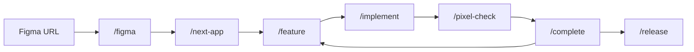

<div align="center">

# figma-next-blueprint

**Paste a Figma link. Get a pixel-perfect Next.js site.**

AI skills that turn your Figma design into a real Next.js website,
one reviewed feature at a time.


</div>

---

## ✨ What it does

- 🎨 **Reads your Figma file** - colors, fonts, spacing, sections, and images
- 🧩 **Builds one section at a time** - each Figma section becomes one React component
- 🎯 **Uses your design tokens** - no random colors or sizes in the code
- 📐 **Checks every pixel** - compares the site with Figma at every screen size
- ✅ **Reviews before it ships** - every feature is planned, built, checked, and approved by you

## 🚀 Quick start

**1. Create a Next.js app**

```bash
npx create-next-app@latest my-site --ts --tailwind --app --eslint
cd my-site
npx shadcn@latest init
npm i -D playwright axe-core
npx playwright install chromium
```

**2. Add the blueprint**

```bash
npx create-figma-next-blueprint@latest
```

**3. Add your Figma token** to a `.env` file in the project root

```env
FIGMA_TOKEN=figd_your_token_here
```

Get one in Figma: **Settings > Security > Personal access tokens** (File content: Read-only).

**4. Open the project in Claude Code and run**

```text
/onboard
/figma <your-figma-url>
```

That's it. The AI maps your design and suggests a build plan.

> 💡 On Windows, keep your project outside OneDrive (for example `C:\dev`).

## 🔁 How it works



1. **`/figma`** reads the design and makes a plan
2. **`/next-app`** builds the base: tokens, fonts, header, footer
3. **`/feature`** → **`/implement`** builds the next page or section
4. **`/pixel-check`** compares it with Figma
5. **`/complete`** saves the work (after you approve)
6. Repeat until the site is done, then **`/release`**

## 🧰 Skills

Type these in your AI chat (Codex uses `$name` instead of `/name`).

| Group | Skills |
| --- | --- |
| **Design** | `/figma` `/next-app` `/section` `/collection` `/assets` `/design-sync` |
| **Build** | `/onboard` `/overview` `/feature` `/implement` `/fix` `/autopilot` |
| **Check** | `/pixel-check` `/check` `/audit` `/tests` |
| **Launch** | `/seo` `/a11y` `/perf` `/release` `/ci` `/complete` |
| **Help** | `/status` `/brief` `/explore` `/debug` `/doctor` `/discovery` `/rollback` |

📖 **A full guide for every skill is coming soon on the website.**

## 📦 Requirements

- Node.js 22+
- Git
- A Figma account and personal access token
- An AI coding agent: [Claude Code](https://claude.com/claude-code), Codex, GitHub Copilot, Antigravity, or OpenCode
- *(Optional)* [Payload CMS](https://payloadcms.com/) if you want an admin panel for content

## 🔄 Update

```bash
npx create-figma-next-blueprint@latest --update
```

Your plans, design map, and project files are never touched.

## 🙏 Credits

Built on [AI Blueprint](https://github.com/aiblueprinthq/ai-blueprint) by Brad Traversy.

Released under the [MIT License](LICENSE).
